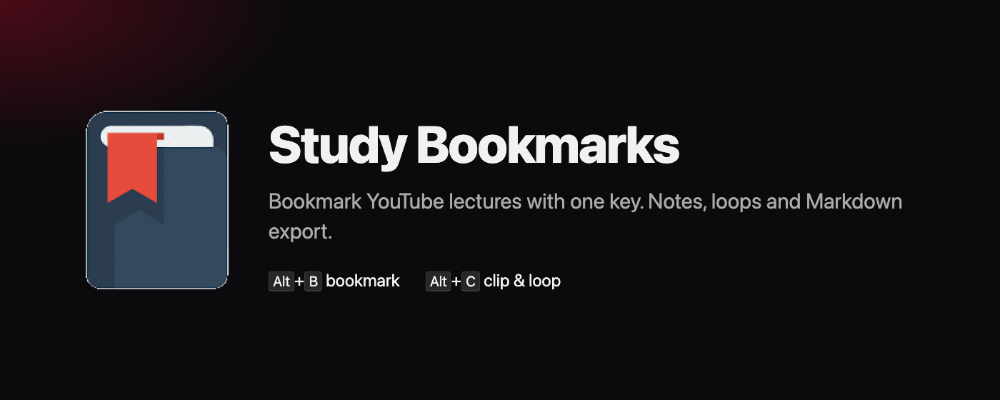
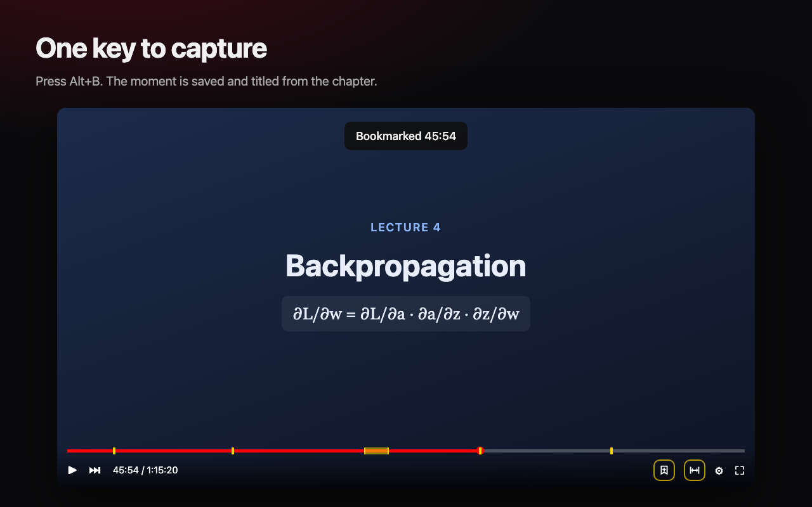
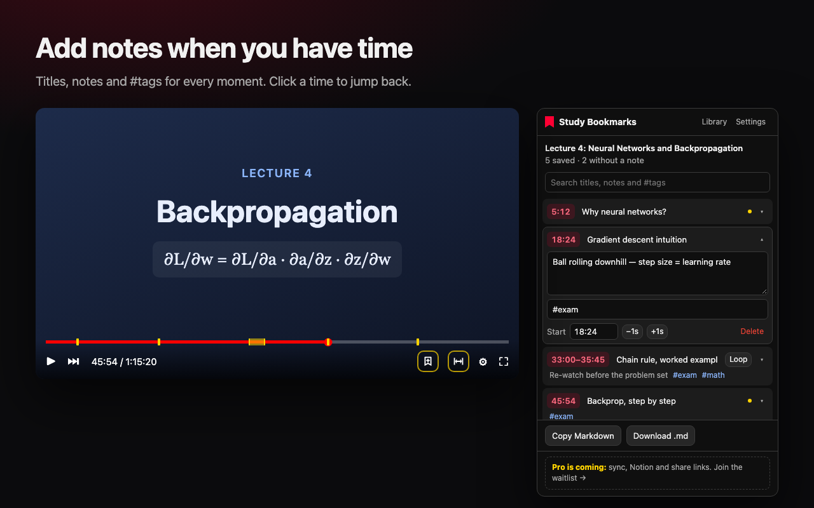
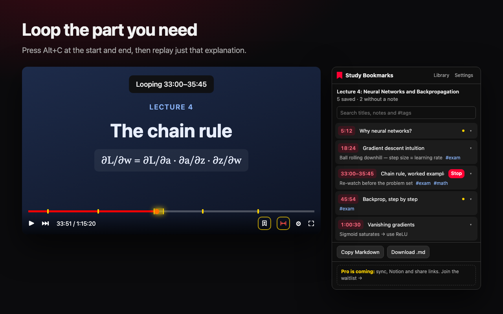
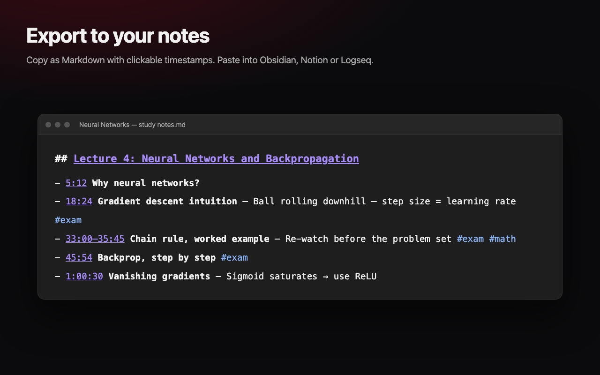
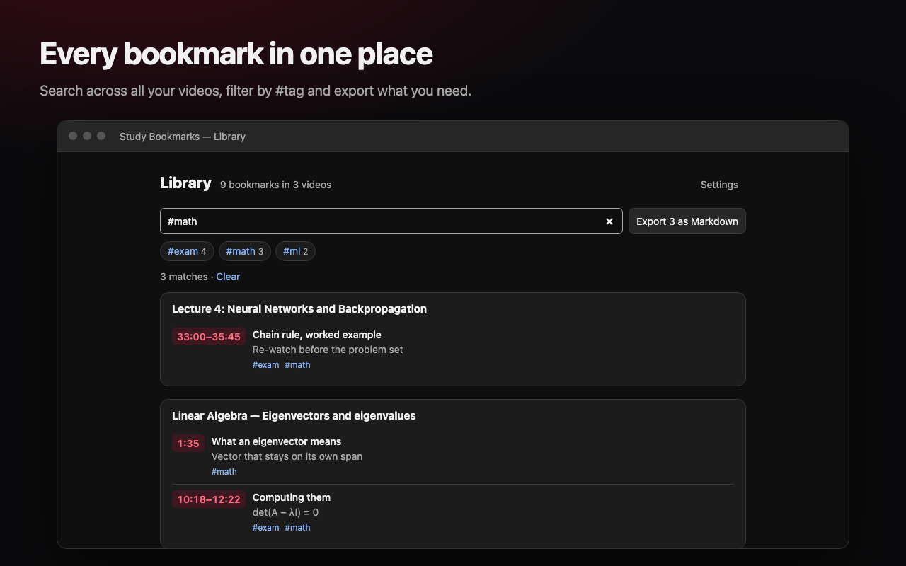
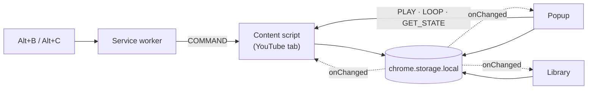

<div align="center">



# YouTube Study Bookmarks

**Bookmark the moments that matter in YouTube lectures with one key. Add notes, loop the hard parts and export everything to your notes app.**

[](https://github.com/UzairJIqbal/youtube_bm/actions/workflows/release.yml)
[](https://github.com/UzairJIqbal/youtube_bm/releases/latest)
[](LICENSE)


[Features](#features) · [Install](#install) · [How it works](#how-it-works) · [Development](#development) · [Architecture](docs/architecture.md) · [Privacy](https://uzairjiqbal.github.io/youtube_bm/privacy.html)

</div>

---

## Why

Long lectures and tutorials are where people learn the most on YouTube, and where they lose the most time. You need to find "the part where she explained the chain rule" again, but YouTube's own tools are made for watching, not studying. Existing bookmark extensions make you pause and type a label, which breaks your focus.

Study Bookmarks keeps you in the video. One key saves the moment and titles it from the chapter. You add notes later, when you have time.

## Features

<table>
<tr>
<td width="50%"></td>
<td width="50%"></td>
</tr>
<tr>
<td><b>One key to capture.</b> <kbd>Alt</kbd>+<kbd>B</kbd> saves the current moment, titled automatically from the video's chapter. Markers show up on the progress bar.</td>
<td><b>Notes when you have time.</b> Add a title, a note and #tags to any bookmark. Nudge the time by a second or type an exact one.</td>
</tr>
<tr>
<td></td>
<td></td>
</tr>
<tr>
<td><b>Clip and loop.</b> Press <kbd>Alt</kbd>+<kbd>C</kbd> at the start and end of an explanation, then replay just that part until it sinks in.</td>
<td><b>Export to your notes.</b> Copy Markdown with clickable timestamp links for Obsidian, Notion or Logseq, or download a <code>.md</code> file.</td>
</tr>
<tr>
<td colspan="2"></td>
</tr>
<tr>
<td colspan="2"><b>Every bookmark in one place.</b> The library searches titles, notes and tags across all your videos, filters by tag and exports what you find.</td>
</tr>
</table>

Also included:

- **Automatic rewind:** captures a few seconds earlier, to make up for pressing late
- **Backup and restore** as a file, including imports from the original version of this extension
- **Private by design:** no account, no tracking, no server; data stays in your browser

## Install

Works in Chrome and Microsoft Edge. The Edge Add-ons listing is on its way. Until then:

1. Download `youtube-study-bookmarks.zip` from the [latest release](https://github.com/UzairJIqbal/youtube_bm/releases/latest) and unzip it.
2. Open `chrome://extensions` (in Edge, `edge://extensions`) and turn on **Developer mode**.
3. Click **Load unpacked** and choose the unzipped folder.
4. Open any YouTube video and press <kbd>Alt</kbd>+<kbd>B</kbd>.

## How it works



There is no backend. A content script adds the buttons, markers and loop to YouTube's player. The popup, library and settings pages are React apps. Everything shares `chrome.storage.local` and stays in sync through its change events. The full write-up, with the data model and design decisions, is in [docs/architecture.md](docs/architecture.md).

### Engineering highlights

- **Minimal permissions.** Only `storage` and `youtube.com`, with no `tabs` permission and no remote code.
- **Built for a single-page app.** YouTube never reloads between videos, so the content script follows `yt-navigate-finish`, resets per-video state and waits for the player before injecting anything.
- **One file knows YouTube's DOM.** Every selector lives in [`player.ts`](src/content/player.ts), so a YouTube redesign is a one-file fix. That paid off when YouTube's 2025 player started squeezing third-party icons to dots.
- **Tested against the real thing.** The Playwright suite loads the built extension and drives live YouTube videos end to end. Unit tests cover the storage, search, export and import logic.
- **Two builds, one toolchain.** Vite builds the React pages and module service worker. A second Vite config bundles the content script as a classic IIFE, because Chrome can't load content scripts as modules.

### Tech stack

| | |
|---|---|
| Extension | Chrome Manifest V3, service worker, content script |
| UI | React 19 with the React Compiler, TypeScript (strict), plain CSS |
| Build | Vite 8 (Rolldown) |
| Tests | Vitest, Playwright |
| CI/CD | GitHub Actions: lint, test, build, release |
| Site | GitHub Pages ([landing page](https://uzairjiqbal.github.io/youtube_bm/), [privacy policy](https://uzairjiqbal.github.io/youtube_bm/privacy.html)) |

## Development

Requires Node 22 or newer.

```sh
npm install
npm run build          # type-check, then build everything into dist/
npm test               # unit tests (Vitest)
npm run lint
npm run e2e            # end-to-end on live YouTube (Playwright)
npm run zip            # build the store package (Chrome and Edge)
npm run store-assets   # render the screenshots in this README
```

Load `dist/` at `chrome://extensions` → **Load unpacked**, then click reload after each rebuild.

`npm run e2e` needs a network connection and the Playwright browser (`npx playwright install chromium`). It runs headless in a throwaway profile, so it never touches your own Chrome.

### Project structure

```
src/
├── content/      content script: player buttons, capture, loop, markers
│   └── player.ts every YouTube selector, in one place
├── background/   service worker: shortcuts, install, migration
├── popup/        toolbar popup (React)
├── library/      all bookmarks with search and tag filters (React)
├── options/      settings, backup and import (React)
├── shared/       storage, types, messages, Markdown, search (+ unit tests)
└── ui/           shared theme and helpers
public/           manifest, injected CSS, icons
e2e/              Playwright test against live YouTube
store-assets/     harness that renders the store and README screenshots
docs/             architecture notes and the GitHub Pages site
```

### Releasing

Bump `version` in [`public/manifest.json`](public/manifest.json) and push a matching tag (`v1.0.1`). The workflow lints, tests and builds, then attaches the store zip to a GitHub release. Store listing copy and the privacy disclosures are in [CHROMEWEBSTORE.md](CHROMEWEBSTORE.md) and [EDGEADDONS.md](EDGEADDONS.md).

## Roadmap

- [x] One-key capture, clips and loop, progress-bar markers
- [x] Notes, tags, library search, Markdown export, backup
- [ ] Microsoft Edge Add-ons release
- [ ] Chrome Web Store release
- [ ] Optional sync across devices
- [ ] Notion export and shareable bookmark lists

Have an idea or found a bug? [Open an issue](https://github.com/UzairJIqbal/youtube_bm/issues/new/choose).

## License

[MIT](LICENSE) © Uzair Iqbal
