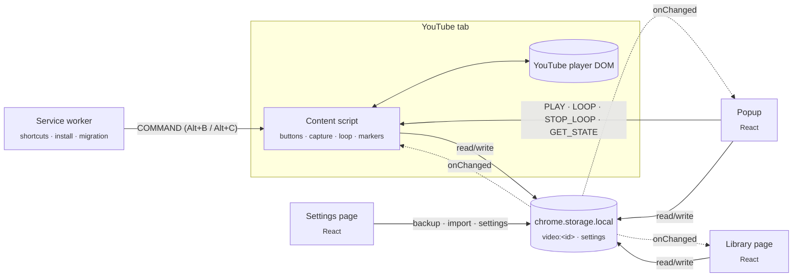
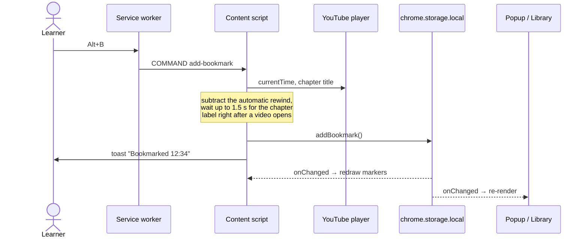

# Architecture

YouTube Study Bookmarks is a Manifest V3 Chrome extension with no backend. Four parts share one store, `chrome.storage.local`, and stay in sync by listening to its change events.



## Parts

| Part | Entry | Responsibility |
|---|---|---|
| Content script | [`src/content/index.ts`](../src/content/index.ts) | Injects the bookmark and clip buttons into the player, captures the current time and chapter title, draws markers on the progress bar, runs the clip loop, and answers messages from the popup. |
| Player adapter | [`src/content/player.ts`](../src/content/player.ts) | The only file that knows YouTube's DOM. Every selector lives here, so a YouTube redesign is a one-file fix. |
| Service worker | [`src/background/index.ts`](../src/background/index.ts) | Forwards keyboard shortcuts to the active tab, opens the welcome page on install, and migrates data from the original version of the extension. Holds no state. |
| Popup | [`src/popup/`](../src/popup/) | Bookmarks for the video in the current tab: jump, loop, edit, nudge the time, search, export. |
| Library | [`src/library/`](../src/library/) | Every bookmark across all videos, with multi-word search, tag filters and export. |
| Settings | [`src/options/`](../src/options/) | Automatic rewind, shortcut help, backup and import, the welcome screen. |
| Shared | [`src/shared/`](../src/shared/) | Storage, types, messages, time parsing, Markdown export, backup format and search. Pure functions, unit tested. |

## Data model

One storage key per video keeps writes small and avoids rewriting a single large blob on every bookmark.

```ts
"video:<videoId>" → {
  videoId: string
  videoTitle: string
  updatedAt: number
  bookmarks: {
    id: string
    start: number     // seconds
    end?: number      // present only for clips
    title: string     // filled from the chapter title on capture
    note: string
    tags: string[]
    createdAt: number
  }[]                 // kept sorted by start
}

"settings" → { offsetSeconds: number }
```

A video whose last bookmark is deleted is removed from storage entirely.

## Capturing a bookmark



## Design decisions

**The content script is a separate IIFE build.** Chrome can't load content scripts as ES modules, so [`vite.content.config.ts`](../vite.content.config.ts) bundles it into a single classic script. The pages and the service worker use the normal multi-page Vite build.

**YouTube is a single-page app.** The content script re-runs its setup on YouTube's `yt-navigate-finish` event, resets per-video state when the video ID changes, and waits for the player controls before injecting anything.

**Minimal permissions.** Only `storage` and `https://www.youtube.com/*`. The host permission already lets the popup read the URL of a YouTube tab, so the extension doesn't need the broader `tabs` permission, which would expose the URL of every tab. Playback state comes from the content script (`GET_STATE`).

**Local-first and private.** No network requests, analytics or accounts. Backup and Markdown export are plain files the user saves.

**Resilient to YouTube's markup.** YouTube's 2025 player pads every control icon by 12px, which collapsed the injected icons to dots. The overrides in [`public/content.css`](../public/content.css) pin them back to 24px, and the e2e test checks the rendered width on every run.

## Testing

| Layer | Tool | What it covers |
|---|---|---|
| Unit | Vitest (`npm test`) | Time parsing and formatting, URL parsing, Markdown export, backup and legacy import, search and tag counts, and storage logic against an in-memory `chrome.storage` fake. |
| End to end | Playwright (`npm run e2e`) | Loads the built extension into Chromium and drives real YouTube videos: button injection, capture, toasts, chapter titles, clips, markers, loop wrap-around, the library, and single-page navigation between videos. |
| CI | GitHub Actions | Lint, unit tests and the store zip on every push. Tags matching `v*` publish the zip as a GitHub release. |

The e2e test runs locally rather than in CI, because it depends on live YouTube.
